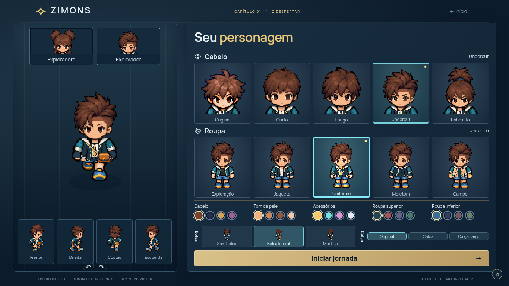
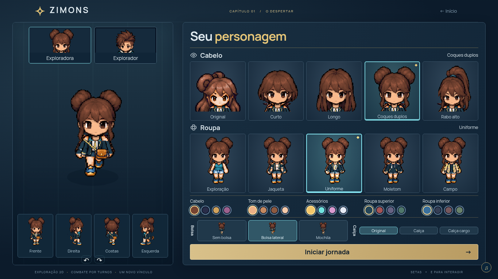
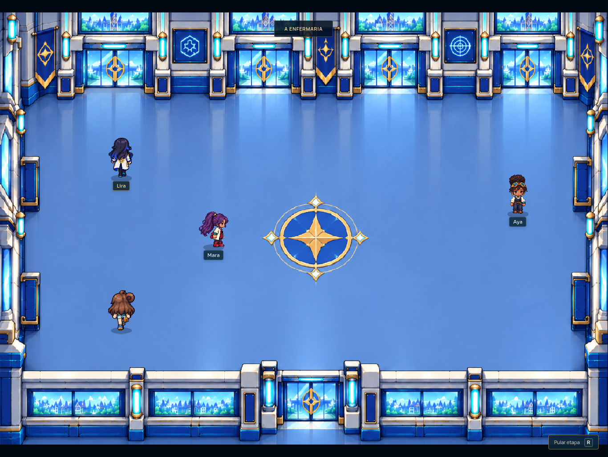
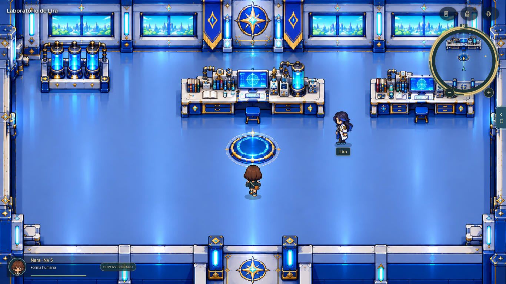
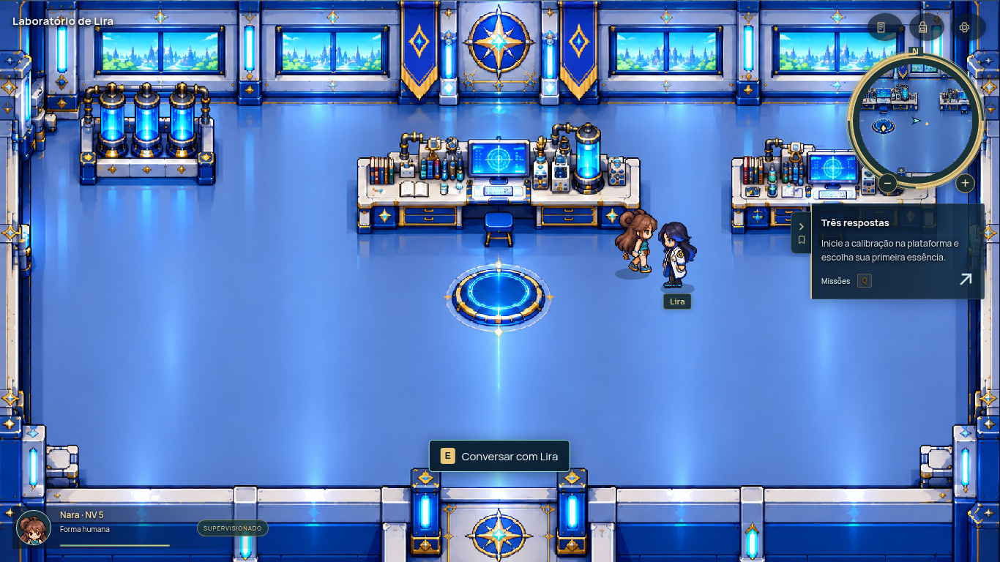
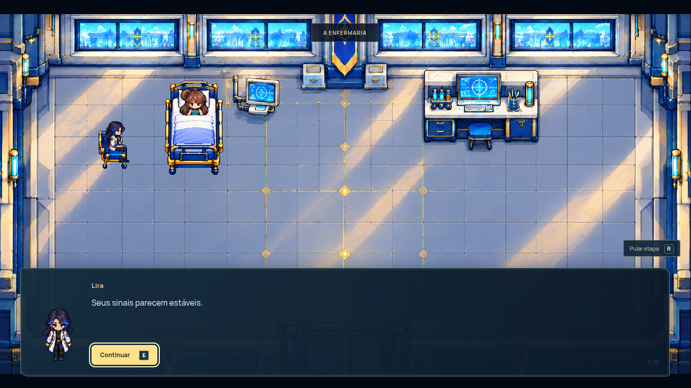
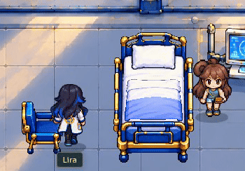
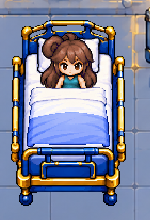

# Capturas reais · Marco A · revisão 4

**Para avaliação; não constitui aprovação do Marco A.** Estas imagens foram extraídas do jogo em Chromium. Os PNGs enviados pelo autor são os assets de cenário; não foram apresentados isoladamente como capturas.

## Tela inicial e personalização

As capturas abaixo usam a mesma composição humana e os mesmos assets preservados nesta revisão. As alterações recentes de portas não modificaram esses recursos.

[Entrada 1366×768](images/entrada-1366.png) · [Entrada 1920×1080](images/entrada-1920.png)

[Masculino caminhando nas quatro direções, 1×](../marco-a-r3/videos/protagonista-masculino-1x.mp4) · [Feminino personalizado caminhando nas quatro direções, 1×](../marco-a-r3/videos/protagonista-feminina-personalizada-1x.mp4)

## Salão integrado · entrada alinhada

[PNG completo](images/salao-portas-fechadas.png) · [Passagem pela porta, 1× — MP4](videos/porta-salao-1x.mp4) · [Sequência de quadros reais](images/sequencia-porta.png)

A abertura foi preservada. A nova trajetória resolve as curvas antes do ponto de aproximação e mantém o trecho final no eixo da entrada, sem ajuste lateral junto à porta. A porta permanece aberta enquanto houver um ocupante na passagem.

## Laboratório integrado

[PNG completo](images/laboratorio-sem-painel.png) · [Circulação no laboratório, 1× — MP4](videos/circulacao-laboratorio-1x.mp4) · [Colisões nas bancadas, cilindros e cadeiras; interação com scanner — MP4](videos/laboratorio-colisoes-1x.mp4)

## Enfermaria preservada, encaixes ajustados

[PNG completo](images/enfermaria.png) · [Aproximação, deitar, sentar e levantar, 1× — MP4](videos/enfermaria-1x.mp4) · [Sequência de quadros reais](images/sequencia-enfermaria.png)

[Detalhe em resolução nativa](images/lencol-detalhe.png)

## Origem e limites

- Percurso registrado usando botões e setas reais; sem alteração de posições, progresso ou estado para montar cenas.
- Velocidade normal do jogo, sem aceleração do vídeo ou interpolação de quadros. Vídeos completos de página gravados a 25 quadros/s, sem áudio; GIFs mostram recortes dos mesmos quadros a 12 quadros/s.
- A captura geral e o vídeo da porta usam viewport 1366×1028 para mostrar a passagem inteira. Laboratório e enfermaria usam 1366×768. O mapa conserva a proporção, com acompanhamento de câmera na janela mais baixa.
- O vídeo da enfermaria une dois trechos. Apenas a conversa entre permanecer sentada e levantar foi retirada; os movimentos foram mantidos em velocidade normal.
- [Tempos e arquivos de origem](videos/ORIGEM.json) · [Linha do tempo completa da gravação](runs/approved-final/timeline.json).
- [Relatório separado: código, testes e pendências](RELATORIO.md).
